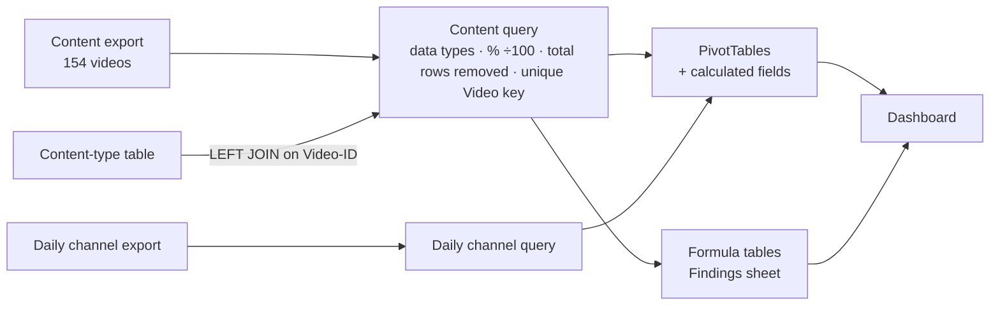

# YouTube Content Performance Analysis – The Meowtrix (Excel)

🇹🇷 [Türkçe versiyon](README_TR.md)

The aim of this project is to analyse the content formats of **The Meowtrix**, a cat-themed YouTube Shorts channel that I ran. The analysis sets out, with numerical evidence, in which respects each content type is stronger than the others, and on the basis of this comparison determines which format the channel should pursue in its future videos.

The study covers 14 months of YouTube Studio data from July 2025 to September 2026: 154 videos, 35.7M views and 31.8K net subscribers. The raw CSV files were cleaned in Power Query and turned into a data model, after which a filterable dashboard and a formula-based findings sheet were built.


<sub>The dashboard consists of content-type and video slicers, publish-date and watch-date timelines, five KPI cards and a channel trend. A single metric selector updates the charts and the Top 10 list together.</sub>


<sub>When "Ort. İzlenme %" (average percentage viewed) is selected in the metric selector, the charts and the Top 10 list are re-sorted by the new metric. Filtering with the content-type slicer updates the KPI cards and the charts together.</sub>

**Tools:** Excel · Power Query (M) · PivotTables & calculated fields · dynamic array formulas (FILTER, SORTBY, TAKE, LET, INDEX/MATCH) · slicers & timelines

---

## Summary
- In per-video performance, the strongest formats were Votkak Edit and Skull Edit. Their median views are around **33K**, which is **6.5 times** the median of Compilation videos (5.1K).
- In the channel's first month, different formats were tried in a mixed way and the median remained at **1.7K views**. Once most uploads shifted to edit formats, the median rose to **34K–41K**, roughly **20 times** higher.
- In the final period only Ranking videos were published, and this period coincided with fewer viral videos. While 5.5% of Ranking videos exceeded 100K views, this rate was **19%** for Votkak Edit.
- In this dataset, averages alone give misleading results. **78%** of Skull Edit views come from a single viral video, and for Votkak Edit the top 10 videos account for about 95% of views. For this reason, medians and 100K+ rates were used alongside averages in all comparisons.

---

## Questions Addressed
The channel progressed through different content formats over its lifetime. The analysis was built around the following three questions in order to identify the performance of these formats and to understand what results can be achieved with each of them:
1. Independent of total views, which format delivers the best result **per video**?
2. How did changes in the content mix affect the channel's performance?
3. Which formats should the channel prioritise from now on, and how should this decision be tested?

## Data & Model
Five YouTube Studio exports (CSV) were used in the analysis: a video-level content table, daily channel metrics, traffic sources and a geographic breakdown. In addition, the content format of each of the 154 videos was identified and added to the data as 5 content types.



---

## Findings

### 1. Per-video performance
Total views naturally favour the format that was produced the most. Views per video is a more accurate indicator of each format's efficiency. By this measure, the ranking is as follows: Votkak Edit **410K**, Skull Edit **340K**, Ranking **114K**, Compilation **11K**.


**Interpretation:** A Compilation video brought in less than 3% of the views of a Votkak Edit video. Compilation is therefore the first format that should be removed from production.

### 2. The effect of outliers on averages
When the dashboard is filtered to Skull Edit, a single video (*Girl vs Boy Cats!*, 9.2M views) can be seen to account for 78% of the type's 11.9M total views. When this video is excluded, Skull Edit's views per video fall from **340K to 78K**. The median (33K) is therefore a more reliable measure for comparing content types.


**Interpretation:** Evaluating a format by its average alone can present a single lucky video as the overall success of the format. Format decisions should take the median and the share of viral videos into account together.

### 3. Content mix by publish month
| Publish month | Main format | Median views / video | Videos ≥100K |
|---|---|---|---|
| Jul 2025 | Mixed (Compilation / Ranking / Other) | 1,713 | 0 |
| Aug 2025 | Skull Edit | 34,385 | 2 |
| Oct 2025 | Votkak Edit | 41,189 | 7 |
| Nov 2025 | Votkak Edit + Ranking | 30,020 | 3 |
| Dec 2025 | Ranking only | 27,232 | 2 |
| Jan 2026 | Ranking only | 26,487 | 0 |


**Interpretation:** The months in which edit videos were published most intensively were also the months with both the highest median and the most 100K+ videos. Ranking maintained a reasonable median, but the number of viral videos fell noticeably during this period.

### 4. Average percentage viewed: weighted vs. simple average
Because Shorts loop back to the start when they end, the average percentage viewed can exceed 100%. The simple average of per-video percentages is calculated as **90.7%**. When each video is weighted by its own views, this value rises to **94.1%**, which is much closer to the figure YouTube reports for the channel (93.1%). With the simple average, the ranking of two content types is also reversed.


**Interpretation:** Counting a video watched a few hundred times with the same weight as one watched millions of times distorts the result. Without weighting, the wrong format would have stood out in terms of percentage viewed.

### 5. Channel trend
The channel's views peaked between September and November 2025 and began to decline from December 2025 onwards.


**Interpretation:** The start of the decline coincides with the period in which only Ranking videos were published. However, timing alone is not enough to conclude that the format change caused the decline (see Limitations).

---

## Recommendations
1. The channel's main output should once again be based on **edit formats (Votkak / Skull Edit)**. Both the highest median and the highest 100K+ rate were observed in these formats.
2. **Ranking should be positioned as a secondary format.** Although its median is reasonable, its rate of viral videos is low.
3. This decision **should be validated with a controlled test.** For about 4 weeks, edit and Ranking videos will be published in the same weeks, and the two formats will be compared on **median views and 100K+ rate**. Since the current analysis is based on historical data, it cannot exclude timing effects such as algorithm changes or the channel's momentum at the time. A parallel test will remove these effects.
4. Performance tracking should look not only at averages but also at **medians and 100K+ rates**. A few viral videos can determine total values on their own.

---

## Method & Data Quality
- **Import & cleaning (Power Query):** Issues caused by encoding and regional settings were resolved, and data types were loaded properly and converted to the correct formats. "Total" rows that doubled every sum were removed from the data.
- **Modelling:** The content-type table was joined to the main table on Video-ID with a LEFT JOIN, and all 154 videos were matched. Grouping by title was found to silently merge **5 pairs of different videos sharing the same title**, so a unique video key made up of the title and publish date was created.
- **Metrics:** View-weighted percentage viewed and the other ratio metrics were built as calculated fields in the PivotTable (sum ÷ sum), so they return the correct result under any filter.
- **Reconciliation:** Total views (35,749,552) match exactly across all exports. The 0.3% difference caused by deleted videos was examined and documented.
- **Interactivity:** The dashboard consists of content-type and video slicers and publish-date and watch-date timelines. A single metric selector updates both charts, the Top 10 list limited to videos with ≥10K views, and the KPI cards together.

### Key Formulas
Calculated fields used so that ratios are computed correctly under every filter (sum ÷ sum):
```
Weighted avg % viewed  = Pct_x_Views / Views
Views per video        = Views / Video_Count
Engagement rate        = (Likes + Comments + Shares) / Views
Subs per 1,000 views   = Subscribers / Views * 1000
```

Top 10 list, sorted by the metric selected in the metric selector (`B31`) and limited to videos with 10K views or more:
```excel
=LET(name, $R$4:$R$300,  hdr, $S$3:$AC$3,  vals, $S$4:$AC$300,
     m,  INDEX(vals, 0, MATCH($B$31, hdr, 0)),
     v,  INDEX(vals, 0, MATCH("Views", hdr, 0)),
     ok, (name<>"") * (name<>"Grand Total") * (v>=10000),
     TAKE(SORTBY(FILTER(HSTACK(name, m), ok), FILTER(m, ok), -1), 10))
```

Calculating the median views for a publish month in the findings table:
```excel
=MEDIAN(FILTER(Content[Views],
        (Content[Publish date]>=$A14) * (Content[Publish date]<=EOMONTH($A14,0))))
```
<sub>The workbook was built in Turkish Excel; formulas are shown here with English function and column names.</sub>

## Limitations
- The findings are observations based on historical data. Since the format changes coincided with the channel's growth period and with changes on the platform, the results show an association between the two, not a cause-and-effect relationship.
- Video-level subscribers gained (39.4K) appear higher than the channel's net subscribers (31.8K). This is because unsubscribes are not attributed to individual videos.
- Monetization started on 13 January 2026 and total revenue remained limited to $2.28. Revenue was therefore not included in the analysis.
- From 27 August 2026, YouTube began counting Shorts views using a different method. Views after this date are negligible and therefore do not affect the results.

## Files
```
Meowtrix_Dashboard.xlsx   Dashboard · Bulgular (findings) · Analiz (pivots & formulas) · data tables
images/                   screenshots used in this README
*.pdf                     PDF versions of this README (EN / TR)
```
> Data is loaded from local CSV files through Power Query. To refresh the file, simply point the queries' source folder to your own folder (Data → Queries & Connections).
