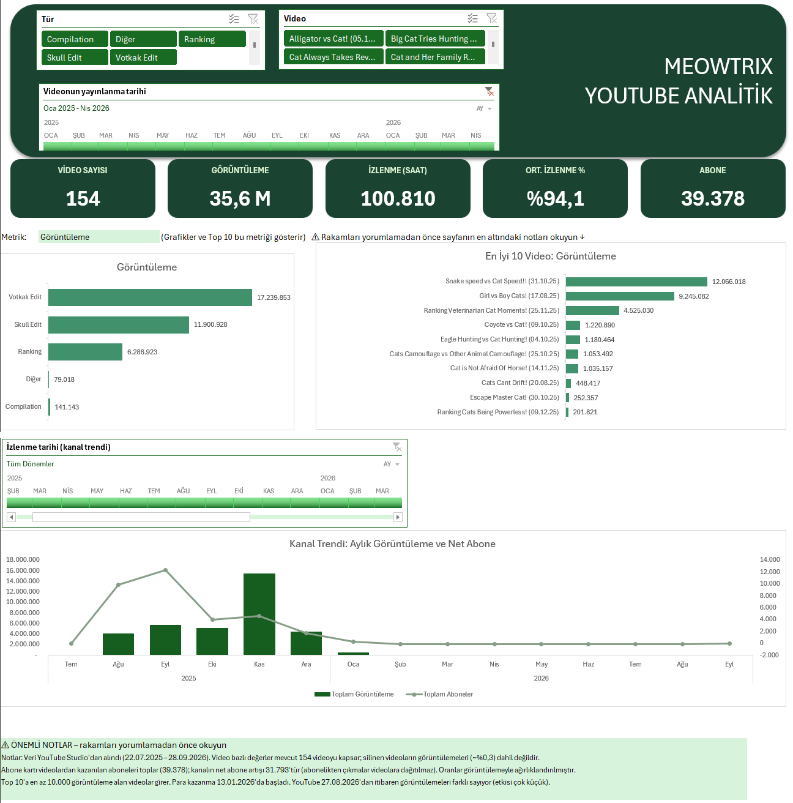
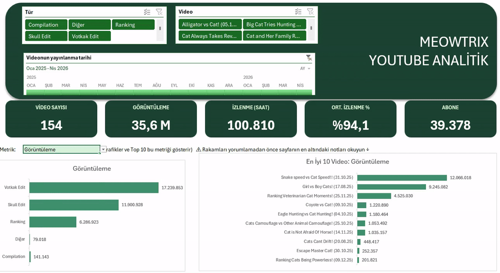
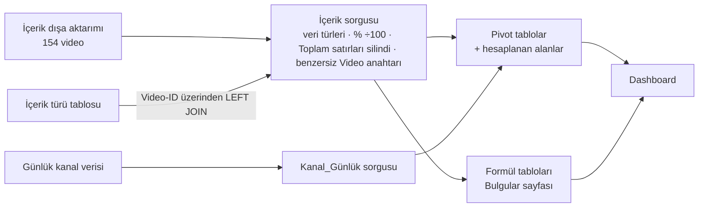
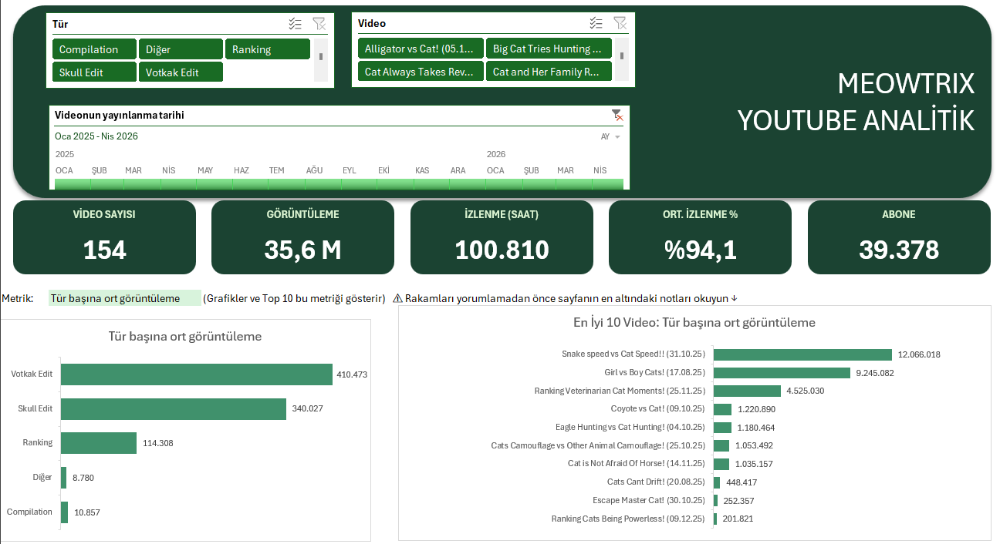
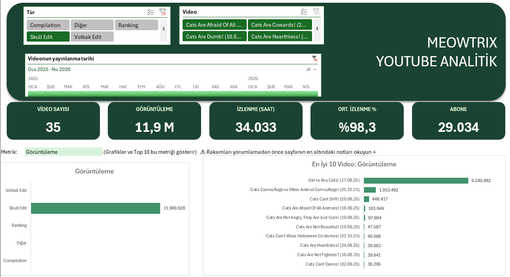
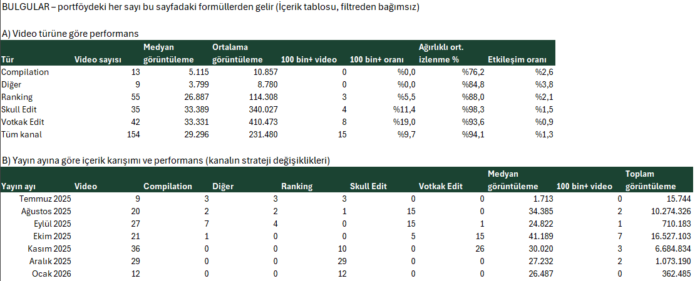
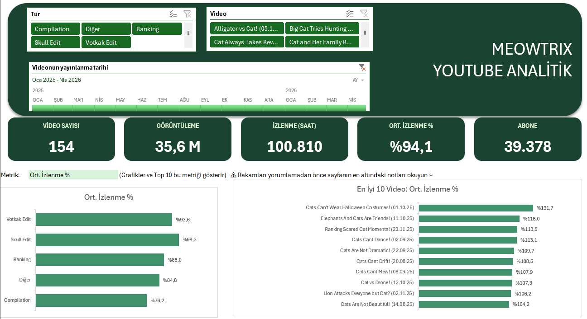
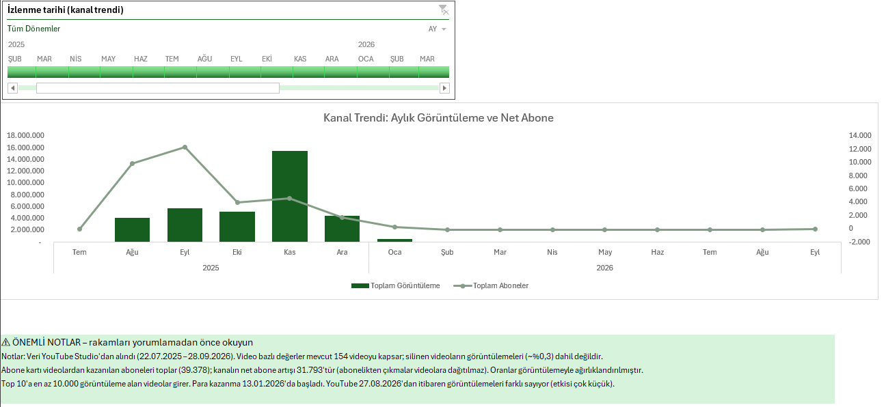

# YouTube İçerik Performans Analizi – The Meowtrix (Excel)

🇬🇧 [English version](README.md)

Bu projenin amacı, yürütmüş olduğum kedi temalı YouTube Shorts kanalı **The Meowtrix**'in içerik formatlarını analiz etmektir. Analizde hangi içerik türünün diğerlerine göre hangi yönlerden daha güçlü olduğu sayısal verilerle ortaya konacak, bu karşılaştırmaya dayanarak kanalın gelecek videolarında hangi formatla ilerlemenin daha mantıklı olduğuna karar verilecektir.

Çalışma, kanalın Temmuz 2025 – Eylül 2026 arasındaki 14 aylık YouTube Studio verisini kapsamaktadır: 154 video, 35,7 milyon görüntüleme ve 31,8 bin net abone. Ham CSV dosyaları Power Query ile temizlenerek bir veri modeline dönüştürülmüş, ardından filtrelenebilir bir dashboard ve formüllerle desteklenen bir bulgular sayfası hazırlanmıştır.



<sub>Dashboard; içerik türü ve video dilimleyicileri, yayın ve izlenme tarihi zaman çizelgeleri, beş KPI kartı ve kanal trendinden oluşmaktadır. Tek bir metrik seçici, grafikleri ve En İyi 10 listesini birlikte güncellemektedir.</sub>



<sub>Metrik seçicide "Ort. İzlenme %" seçildiğinde grafikler ve En İyi 10 listesi yeni metriğe göre yeniden sıralanmaktadır. Tür dilimleyicisiyle yapılan filtreleme ise KPI kartlarını ve grafikleri birlikte güncellemektedir.</sub>

**Kullanılan araçlar:** Excel · Power Query (M) · Pivot tablolar ve hesaplanan alanlar · dinamik dizi formülleri (FİLTRE, SIRALAÖLÇÜT, AL, LET, İNDİS/KAÇINCI) · dilimleyiciler ve zaman çizelgeleri

---

## Özet
- Video başına performansta en güçlü formatlar Votkak Edit ve Skull Edit olmuştur. Bu iki formatın medyan görüntülemesi yaklaşık **33 bin** olup Compilation videolarının medyanının (5,1 bin) **6,5 katıdır**.
- Kanalın ilk ayında farklı formatlar karışık olarak denenmiş ve medyan görüntüleme **1,7 bin** düzeyinde kalmıştır. Yüklemelerin büyük kısmı edit formatına kaydığında medyan **34–41 bine**, yani yaklaşık **20 katına** yükselmiştir.
- Son dönemde yalnızca Ranking videoları yayınlanmış ve bu dönem daha az sayıda viral olan videoyla aynı zamana denk gelmiştir. Ranking videolarının %5,5'i 100 bin görüntülemeyi geçebilirken bu oran Votkak Edit'te **%19**'dur.
- Bu veri setinde ortalamalar tek başına yanıltıcı sonuç vermektedir. Skull Edit görüntülemelerinin **%78'i** tek bir viral videodan gelmekte, Votkak Edit'te ise görüntülemelerin yaklaşık %95'ini ilk 10 video oluşturmaktadır. Bu nedenle karşılaştırmalarda ortalamanın yanında medyan ve 100 bin+ oranları da kullanılmıştır.

---

## Analizde Yanıt Aranan Sorular
Kanal yayın hayatı boyunca farklı içerik formatlarıyla ilerlemiştir. Analiz, bu formatların performanslarını tespit etmek ve hangi formatla nasıl sonuçlar alınabileceğini anlamak amacıyla şu üç soru üzerine kurulmuştur:
1. Toplam görüntülemeden bağımsız olarak, **video başına** en iyi sonucu hangi format vermektedir?
2. İçerik karışımındaki değişiklikler kanalın performansını nasıl etkilemiştir?
3. Kanal bundan sonra hangi formatlara ağırlık vermeli ve bu karar nasıl test edilmelidir?

## Veri ve Model
Analizde YouTube Studio'dan alınan beş dışa aktarım (CSV) kullanılmıştır: video bazında içerik tablosu, günlük kanal metrikleri, trafik kaynakları ve ülke kırılımı. Bunlara ek olarak 154 videonun her birinin hangi içerik formatında olduğu tespit edilmiş ve bu bilgi 5 içerik türü olarak veriye işlenmiştir.



---

## Bulgular

### 1. Video başına performans
Toplam görüntüleme, doğal olarak en çok üretilen formatı öne çıkarmaktadır. Formatların verimliliğini ölçmek için video başına görüntüleme daha doğru bir göstergedir. Bu göstergeye göre sıralama şu şekildedir: Votkak Edit **410 bin**, Skull Edit **340 bin**, Ranking **114 bin**, Compilation **11 bin**.



**Yorum:** Bir Compilation videosu, bir Votkak Edit videosunun getirdiği görüntülemenin %3'ünden azını getirmiştir. Bu nedenle üretimden ilk çıkarılması gereken format Compilation'dır.

### 2. Aykırı değerlerin ortalamaya etkisi
Dashboard Skull Edit'e filtrelendiğinde, tek bir videonun (*Girl vs Boy Cats!*, 9,2 milyon görüntüleme) türün toplam 11,9 milyon görüntülemesinin %78'ini oluşturduğu görülmektedir. Bu video hesaba katılmadığında Skull Edit'in video başına görüntülemesi **340 binden 78 bine** düşmektedir. Bu nedenle türler arası karşılaştırmada medyan (33 bin) daha güvenilir bir ölçüdür.



**Yorum:** Bir formatı yalnızca ortalamasına bakarak değerlendirmek, tek bir şanslı videoyu formatın genel başarısı gibi gösterebilir. Format kararlarında medyan ve viral olan video oranı birlikte dikkate alınmalıdır.

### 3. Yayın ayına göre içerik karışımı
| Yayın ayı | Ağırlıklı format | Medyan görüntüleme / video | 100 bin+ video |
|---|---|---|---|
| Temmuz 2025 | Karışık (Compilation / Ranking / Diğer) | 1.713 | 0 |
| Ağustos 2025 | Skull Edit | 34.385 | 2 |
| Ekim 2025 | Votkak Edit | 41.189 | 7 |
| Kasım 2025 | Votkak Edit + Ranking | 30.020 | 3 |
| Aralık 2025 | Sadece Ranking | 27.232 | 2 |
| Ocak 2026 | Sadece Ranking | 26.487 | 0 |



**Yorum:** Edit videolarının en yoğun yayınlandığı aylar, hem en yüksek medyanın hem de en fazla 100 bin+ videonun görüldüğü aylar olmuştur. Ranking makul bir medyan seviyesini korumuş, ancak bu dönemde viral olan video sayısı belirgin şekilde azalmıştır.

### 4. İzlenme yüzdesi: ağırlıklı ve basit ortalama
Shorts videoları bittiğinde başa sardığı için ortalama izlenme yüzdesi %100'ün üzerine çıkabilmektedir. Video başına izlenme yüzdelerinin basit ortalaması **%90,7** olarak hesaplanmaktadır. Her video kendi görüntüleme sayısıyla ağırlıklandırıldığında bu değer **%94,1**'e yükselmekte ve YouTube'un kanal için raporladığı değere (%93,1) çok daha yakın bir sonuç vermektedir. Basit ortalama kullanıldığında ise iki içerik türünün sıralaması yer değiştirmektedir.



**Yorum:** Birkaç yüz kez izlenmiş bir videonun, milyonlarca kez izlenmiş bir videoyla aynı ağırlıkta sayılması sonucu bozmaktadır. Ağırlıklandırma yapılmasaydı izlenme yüzdesi açısından yanlış format öne çıkacaktı.

### 5. Kanal trendi
Kanalın görüntülemeleri Eylül–Kasım 2025 döneminde zirveye ulaşmış ve Aralık 2025'ten itibaren düşüşe geçmiştir.



**Yorum:** Düşüşün başladığı dönem, yalnızca Ranking videolarının yayınlandığı döneme denk gelmektedir. Ancak yalnızca zamanlamaya bakarak bu düşüşün nedeninin format değişikliği olduğu söylenemez (bkz. Sınırlılıklar).

---

## Öneriler
1. Kanalın ana üretimi yeniden **edit formatlarına (Votkak / Skull Edit)** dayandırılmalıdır. En yüksek medyan ve en yüksek 100 bin+ oranı bu formatlarda görülmüştür.
2. **Ranking ikincil format** olarak konumlandırılmalıdır. Medyanı fena olmasa da viral olan video oranı düşüktür.
3. Bu karar **kontrollü bir testle doğrulanmalıdır.** Yaklaşık 4 hafta boyunca edit ve Ranking videoları aynı haftalarda yayınlanacak ve iki format **medyan görüntüleme ve 100 bin+ oranı** üzerinden karşılaştırılacaktır. Mevcut analiz geçmiş veriye dayandığı için algoritma değişiklikleri veya kanalın o dönemki ivmesi gibi zamanlama etkilerini dışarıda bırakamamaktadır. Paralel bir test bu etkileri ortadan kaldıracaktır.
4. Performans takibinde yalnızca ortalamalara değil, **medyan ve 100 bin+ oranlarına** da bakılmalıdır. Birkaç viral video toplam değerleri tek başına belirleyebilmektedir.

---

## Yöntem ve Veri Kalitesi
- **İçe aktarma ve temizlik (Power Query):** Kodlama ve bölge ayarından kaynaklanan sorunlar giderilmiş, veri türleri düzgün şekilde yüklenerek doğru formatlara çevrilmiştir. Toplamları iki katına çıkaran "Toplam" satırları veriden kaldırılmıştır.
- **Modelleme:** İçerik türü tablosu, Video-ID üzerinden LEFT JOIN ile ana tabloya bağlanmış ve 154 videonun tamamı eşleşmiştir. Başlığa göre gruplama yapıldığında aynı başlığı taşıyan **5 çift farklı videonun** fark edilmeden birleştiği tespit edilmiş, bu nedenle başlık ve yayın tarihinden oluşan benzersiz bir video anahtarı oluşturulmuştur.
- **Metrikler:** Ağırlıklı izlenme yüzdesi ve diğer oran metrikleri, pivot tabloda hesaplanan alan olarak (toplam ÷ toplam) kurulmuştur. Böylece hangi filtre uygulanırsa uygulansın doğru sonuç vermektedir.
- **Mutabakat:** Toplam görüntüleme (35.749.552) bütün dışa aktarımlarda birebir tutmaktadır. Silinmiş videolardan kaynaklanan %0,3'lük fark incelenmiş ve kayıt altına alınmıştır.
- **Etkileşim:** Dashboard, içerik türü ve video dilimleyicileri ile yayın ve izlenme tarihi zaman çizelgelerinden oluşmaktadır. Tek bir metrik seçici, iki grafiği, ≥10 bin görüntülemeli videolarla sınırlandırılmış En İyi 10 listesini ve KPI kartlarını birlikte güncellemektedir.

### Temel Formüller
Oranların her filtrede doğru hesaplanması için kullanılan hesaplanan alanlar (toplam ÷ toplam):
```
Ağırlıklı Ort. Yüzde        = Yuzde_x_Goruntuleme / Görüntüleme
Video Başına Görüntüleme    = Görüntüleme / Video_Sayisi
Etkileşim Oranı             = (Beğenenler + Yorumlar + Paylaşım) / Görüntüleme
Abone per 1000 Görüntüleme  = Aboneler / Görüntüleme * 1000
```

Metrik seçicide (`B31`) seçili olan metriğe göre sıralanan ve yalnızca 10 bin ve üzeri görüntülemeli videoları içeren En İyi 10 listesi:
```excel
=LET(ad; $R$4:$R$300;  tb; $S$3:$AC$3;  v; $S$4:$AC$300;
     m;  İNDİS(v; 0; KAÇINCI($B$31; tb; 0));
     g;  İNDİS(v; 0; KAÇINCI("Görüntüleme "; tb; 0));
     ok; (ad<>"") * (ad<>"Genel Toplam") * (g>=10000);
     AL(SIRALAÖLÇÜT(FİLTRE(YATAYYIĞ(ad; m); ok); FİLTRE(m; ok); -1); 10))
```

Bulgular tablosunda bir yayın ayına ait medyan görüntülemenin hesaplanması:
```excel
=ORTANCA(FİLTRE(İçerik[Görüntüleme];
         (İçerik[Videonun yayınlanma tarihi]>=$A14) * (İçerik[Videonun yayınlanma tarihi]<=SERİAY($A14;0))))
```

## Sınırlılıklar
- Bulgular geçmiş veriye dayanan gözlemlerdir. Format değişiklikleri kanalın büyüme dönemi ve platformdaki değişikliklerle aynı zamana denk geldiğinden, sonuçlar neden-sonuç ilişkisini değil, iki durum arasındaki ilişkiyi göstermektedir.
- Video bazında kazanılan abone sayısı (39,4 bin), kanalın net abone sayısından (31,8 bin) yüksek görünmektedir. Bunun nedeni, abonelikten çıkmaların videolara dağıtılmamasıdır.
- Para kazanma 13 Ocak 2026'da başlamış ve toplam gelir 2,28 $ ile sınırlı kalmıştır. Bu nedenle gelir analize dahil edilmemiştir.
- YouTube, 27 Ağustos 2026'dan itibaren Shorts görüntülemelerini farklı bir yöntemle saymaya başlamıştır. Bu tarihten sonraki görüntülemeler ihmal edilebilir düzeyde olduğundan sonuçları etkilememektedir.

## Dosyalar
```
Meowtrix_Dashboard.xlsx   Dashboard · Bulgular · Analiz (pivotlar ve formüller) · veri tabloları
images/                   README'de kullanılan ekran görüntüleri
*.pdf                     README'nin PDF versiyonları (EN / TR)
```
> Veriler Power Query aracılığıyla yerel CSV dosyalarından yüklenmektedir. Dosyayı yenilemek için sorguların kaynak klasörünü kendi klasörünüzle değiştirmeniz yeterlidir (Veri → Sorgular ve Bağlantılar).
